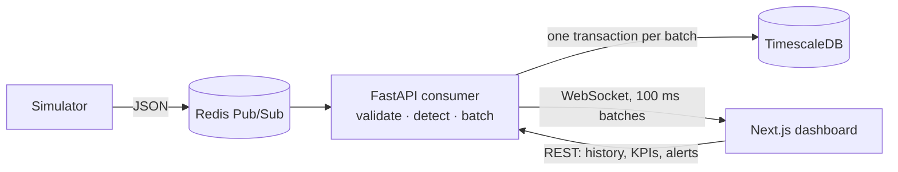

# GridPulse — Real-Time Smart Grid Analytics

### 🔴 Live demo: <https://gridpulse-mmlk.onrender.com>

> Hosted on Render's free tier: if nobody has visited for 15 minutes, the first load takes about a minute while the service wakes up. Data is simulated and restarts with the service. API docs: <https://gridpulse-mmlk.onrender.com/docs>

GridPulse simulates household smart meters with rooftop solar, streams their readings through Redis into a FastAPI service, stores them in TimescaleDB, flags unusual demand with a rolling z-score detector, and shows everything live on a Next.js dashboard.

**Stack:** Python 3.13 · FastAPI · asyncio · Redis Pub/Sub · PostgreSQL 16 + TimescaleDB · asyncpg · Next.js 16 · React 19 · TypeScript · Recharts · Docker Compose · Caddy · Render

## Quickstart

Requires Docker with Compose.

```bash
docker compose up --build
```

- Dashboard: <http://localhost:3000>
- API health: <http://localhost:8000/health> · interactive API docs: <http://localhost:8000/docs>

The first build takes several minutes. A simulator starts automatically (5 meters, one reading each every 2 seconds). If ports 8000 or 3000 are taken, see [docs/DEPLOYMENT.md](docs/DEPLOYMENT.md#changing-ports).

## What it does

- **Simulation:** daily demand curves with morning and evening peaks, a daylight solar curve, seeded Gaussian noise, and occasional injected demand surges recorded as ground truth.
- **Ingestion:** an async Redis consumer validates every message and saves readings in batched transactions (one commit per batch of waiting messages).
- **Live streaming:** readings and alerts are pushed over WebSockets in 100 ms batches; slow clients are dropped; the browser reconnects with capped exponential backoff.
- **Analytics:** time-bucketed history (`time_bucket`), energy KPIs computed with a SQL window function (`LEAD`) — grid import/export, solar coverage, peak load.
- **Anomaly detection:** per-meter rolling z-score with warm-up, a standard-deviation floor, and clipped baselines; alerts are stored, streamed, and merged with history on the dashboard.

## Architecture



Details, design trade-offs, configuration, and limitations: [docs/ARCHITECTURE.md](docs/ARCHITECTURE.md).

## API

| Endpoint | Returns |
|---|---|
| `GET /health` | Consumer status and counters (503 if a background task stopped) |
| `GET /readings/latest` | Latest stored reading per meter |
| `GET /readings/count` | Number of stored readings |
| `GET /readings/history?start&end&bucket_seconds` | System-wide averages per time bucket |
| `GET /analytics/kpis?start&end` | Energy (kWh), import/export, solar coverage, peak load |
| `GET /alerts?start&end&limit` | Stored anomaly alerts, newest first |
| `WS /ws/readings` | Live batches: `{"type": "readings", "readings": [...], "alerts": [...]}` |

## Measured results

All numbers were measured on one development laptop (Intel Core i3-6006U, 2 cores, 7.9 GB RAM) running every component at once; they are not production capacity claims. Method and full tables are in [docs/LEARNING_LOG.md](docs/LEARNING_LOG.md) (Phase 7).

| Measurement | Result |
|---|---|
| Throughput, one commit per reading | 36–77 readings/s |
| Throughput, batched commits | Kept up with every offered rate, up to 385 readings/s delivered (load generator limit) |
| End-to-end latency, batched (publish → WebSocket) | p50 79–151 ms, p95 ≤ 703 ms at 50–400 readings/s offered |
| Readings lost in load tests | 0 |
| Anomaly detection on held-out seeds (threshold 4.0) | precision 0.913–0.953, recall 0.995–1.000 |

Simulated faults (3–8 kW surges over 0.08 kW noise) are far easier to detect than real-world faults, so detection figures are optimistic.

## Tests

```bash
python -m unittest discover -s tests        # 43 Python tests
npm --prefix frontend test                  # 24 frontend tests (Vitest)
npm --prefix frontend run typecheck
npm --prefix frontend run lint

python -m tests.evaluate_anomaly --seed 7   # score the detector against injected faults
python -m tests.load_test --help            # throughput / latency load test
```

## Deployment

The live demo runs on Render's free web service, defined as code in [`render.yaml`](render.yaml) and redeployed automatically on every push to `main`.

Free hosts run **one container on one port**, so the root [`Dockerfile`](Dockerfile) packages every service as a process in one image: Redis, PostgreSQL + TimescaleDB, the FastAPI API, the simulator, the Next.js dashboard, and **Caddy** as the single public entry point. Caddy routes API and WebSocket paths to FastAPI and everything else to the dashboard, so the browser sees one origin and needs no CORS. A start script launches the services in dependency order and exits if any of them stops, so the host restarts the container.

- **Memory:** all processes share 512 MB, so Postgres and Next.js memory are capped. Measured locally under a 512 MB limit: about 146–210 MiB in use, no out-of-memory kill.
- **Lesson from the first deploy:** Render runs containers with fewer Linux capabilities than Docker Desktop, and the official Caddy binary failed with `Operation not permitted` (exit 126). The image now strips that unneeded capability; test locally like Render with `docker run --cap-drop ALL --memory 512m -e PORT=10000 -p 10000:10000 <image>`.

Step-by-step instructions, free-tier trade-offs, and what a production deployment would add: [docs/DEPLOYMENT.md](docs/DEPLOYMENT.md).

## Project layout

```
simulator/      reading model, profiles, generator, publisher, CLI
backend/app/    FastAPI app, consumer, anomaly detector, repository (SQL), WebSocket hub
frontend/       Next.js dashboard and Vitest tests
tests/          Python tests, anomaly evaluation, load test
docs/           architecture, deployment, learning log, concepts, interview prep
compose.yaml    full local stack (one container per service)
Dockerfile      all-in-one image for single-container hosts (the Render demo)
render.yaml     Render Blueprint: free Docker web service with a /health check
deploy/         start script and Caddy proxy config for the all-in-one image
```

## Limitations

Redis Pub/Sub does not replay messages missed while the API is down; detector state resets on restart; there is no authentication (the demo is read-only with simulated data), and HTTPS comes from the host rather than the app; one API instance holds the WebSocket and detector state. On the free demo, storage is temporary. See [docs/DEPLOYMENT.md](docs/DEPLOYMENT.md) before running it anywhere public.
